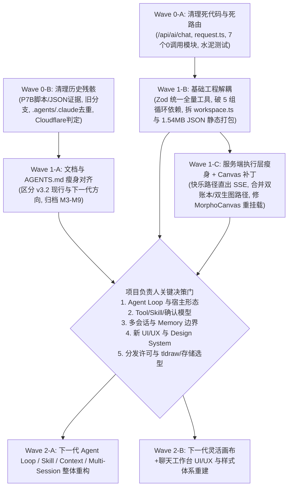

# Morpho 下一阶段工程适用性全仓库审查报告

> **审查性质**：独立、深入、严格只读的全仓库工程适用性审查（不执行任何代码、配置、文档或远端变更）。  
> **目标**：对照 [`docs/product/next-generation-direction.md`](../../../../docs/product/next-generation-direction.md) 的下一阶段目标，剥离历史负担、诊断结构性认知与修改成本，为项目负责人提供可直接用于后续整改与架构演进决策的依据。  
> **配套调查产物**（同目录）：
> - [附录 A：Git 演进基线、代码体量与数据/数据库足迹](./appendix-git-and-footprint.md)
> - [附录 B：死代码、循环依赖、重复机制、前端样式与脚本测试审计](./appendix-code-and-dependency-audit.md)
> - [附录 C：文档体系、`AGENTS.md` 与仓库内 Skills 审查](./appendix-docs-and-rules-audit.md)

---

## 0. 审查基线、覆盖范围与证据边界

### 0.1 Git 与仓库基线（已确认事实）

- **分支与 HEAD**：`main` @ `d55062e7fcdc5dfe0f12b08e43523bee7223dac6`（`Add Agent Lab for repeatable A+ development runs`，2026-11-19）
- **工作树状态**：`git status --short` 仅有一项未跟踪文件 `?? docs/product/next-generation-direction.md`；已跟踪工作树干净；无额外 Git worktree。
- **审查日期**：2026-11-19
- **历史规模**：自 `20cf8bb`（2026-06-23）起共 **706 次提交**、9 条历史分支（本地与远端成对）、5 个标签。
- **代码与文档体量**（全量精确统计见[附录 A](./appendix-git-and-footprint.md)，均按原始文件行统计）：
  - `src/`：572 文件 / 198,736 行（~103,500 行生产 TS/TSX/CSS + 28,020 行内嵌 JSON 夹具 + 66,975 行单元测试 + 232 行 `src/test` Fakes）
  - `e2e/`：58 文件 / 12,181 行（含 Playwright 验收、1,915 行 `performance-phase5.spec.ts` 及 14 个 `e2e/eval/` 冻结契约）
  - `supabase/`：21 文件 / 4,880 行（含 20 个 SQL 迁移）
  - `scripts/`：58 文件 / 5,903 行（其中 33 个为已结项 P7B 脚本）
  - `docs/`：200 文件 / 76,325 行（其中约 48,800+ 行为提交入库的 JSON 证据/基准快照）
  - `.agents/` + `.claude/`：191 个跟踪文件 / 21,314 行（其中 95 个 Skill 文件字节级 100% 双份重复）
  - 本地未跟踪 `output/playwright/`：59,261 个历史运行产物文件。

### 0.2 覆盖范围与未核实边界

- **已直接源码核验范围**：全部目录结构与依赖图（静态全量 import 图 + Tarjan SCC 环检测）、706 次提交演进与分支状态、客户端/共享/服务端 Agent 完整执行链、Agent Lab 与 Zod 只读工具、Domain 核心/迁移/校验/记忆/连续性/交付/文档解析、本地持久化/IndexedDB/Web Locks、Supabase 全量 20 个 SQL 迁移与 Auth/Quota/Journal/Escrow RPC、全部 Next.js API Routes 与安全下载/请求体限流、`WorkspaceClient`/`MorphoCanvas`/`AiConversationPanel`/`OverlayDrawers`/`BottomDetailBar`/`ProjectHomeClient`/`globals.css`、测试与脚本体系、`docs/`、`AGENTS.md`、`.agents/` 与 `.claude/`。
- **明确未验证事项（本轮只读边界）**：
  1. 未执行 `npm test` / `npm run build` / Playwright / `npm run cf:build`（避免在本地产生构建缓存或测试产物变动），因此**未实测当前 HEAD 下单测/构建/E2E 的实时耗时与通过状态**；
  2. 未连接线上 Vercel / Supabase / AiJWS / GrsAI，因此**未核实生产环境的实际环境变量、已应用迁移状态、`pg_cron` 定时任务是否开启，以及真实 Provider 延迟和计费行为**；
  3. 对单测体量与耦合度的判断基于全量目录统计 + 关键测试文件直接阅读（`agentRuntimeArchitecture.test.ts`、`agentRuntimeMigration.test.ts` 等），未逐行阅读全部 244 个单测文件。

---

## 1. 总体判断（Executive Verdict）

### 一句话结论

**Morpho 当前是一台“按高合规、强审计、强分布式防错标准为 v3.2 固化形态建造出来的重型精密机床”，而下一阶段最需要的是“轻快、清晰、易于高频实验的 Design Agent 工作台”。** 仓库里真正有长期生命力的核心资产（local-first 存储可靠性、Auth/Quota、SSRF/限流安全边界、结构化设计对象与版本关系、视觉参考与血缘、文档解析、最新落地的 Zod 工具定义与 Agent Lab）其实只占体量的一小部分；真正拖垮理解和修改速度的，是过去五个月“多轮架构替换 + 14 包整改审计 + 只增不减的兼容/防御/证据堆积”留下的**四座工程大山**。

### 四大结构性拖累（已确认事实 + 架构归因）

1. **AI 执行链被两套叠加的服务端账本与超重客户端状态机淹没，成为研发迭代最大瓶颈**  
   为了给 local-first 单人/内测应用实现跨断线、跨刷新、可取回的“同结果防重付”保障，Morpho 在 2026-07 建了 A+ Turn/Action Journal（4 张 `private` 表 + ~1,740 行有效 SQL + 客户端 1,594 行 `agentTurnLifecycle` + 1,209 行 `agentTurnCoordinator` + 1,812 行 `agentTurnRunner` + 859 行 `agentTurnRecoveryStore`），又在 2026-10（P3A/P3B）在其上**完整叠了第二套** `external_effect*` + `external_result_chunk`（5 张 `public` 表，把文本 JSON 和图片切成 512 KB base64 分片塞进 Postgres）。实测源码调用链显示：**哪怕在 SSE 完好的快乐路径上，单次 LLM 调用也要走 ~12–14 次顺序 Postgres RPC（含重复结算与每次 RPC 触发 4 条清理 DML），且强制走完 Postgres 分片落库 → SSE 仅发清单 → 客户端另起 HTTP 分片回拉 → 本地 ACK outbox 回传的漫长绕路**。整个 AI/Agent/记忆/账本相关代码+SQL 合计超过 **40,000 行**（占生产代码近四成），且核心客户端存在 **6 模块循环依赖**。
2. **前置正则意图解析与僵化合同门禁，直接扼杀下一代 Design Agent 的专业能力实验**  
   为防模型“越权写入或越权花钱”，系统在把消息发给 LLM **之前**，在 **9 个不同文件**里用大量脆弱的中英文正则对自然语言分句、判否定、绑引用、裁工具、决定 `observeGeneratedImages` 与最多 3 个 Method Pack。结果是：用户换一种自然说法（例如“出图后核对”未命中“出图后再评价”正则）就被静默关闭能力；系统 Prompt、Strategy、Method Pack 三层内容高度重复，且版本号与派生列表在服务端做精确 JSON 相等强校验。只要这个“前置正则裁权 + 静态合同锁死”模式不调整，项目负责人亲自主导 Prompt / Skill / Tool / Loop 迭代就会处处碰壁。
3. **派生投影持久化 + 18 版历史迁移 + 1.54 MB 静态内嵌夹具，让数据底座头重脚轻**  
   对仓库内真实案例项目 `currentCaseWorkspace.generated.json`（1.50 MB）的逐字段测算表明：**全部 42 个真实设计对象仅占 100 KB（6.7%）**，而 `projectMemory`（237 KB）与 `projectContinuity`（160 KB）两套并行派生账本合计 **397 KB**，加上 `operations` / `artifactProposals` / `decisionRecords` / `citationSnapshots`，**辅助账本体积超过真实设计对象的 4 倍**。同时 `workspace.ts`（3,519 行，一半是 v1–v18 迁移代码）把 1.50 MB 案例 JSON（还停留在 schema v17）和 39 KB 测试专用 Nightrail 夹具静态 `import` 进了前端包。
4. **“只增不减”的死代码、水泥化测试、追尾式 CSS 与失真文档，正在制造极高的多 Agent 认知税**  
   - 完全无生产调用方的 `/api/ai/chat` + `src/server/ai/request.ts`（1,784 行）、7 个 0 生产调用模块、多处死导出仍在仓库中被测试强制“钉死”（`agentRuntimeArchitecture.test.ts` 甚至断言死路由存在）；
   - `src/app/globals.css` 经过 10+ 轮追加式 polish 膨胀到 **10,165 行**，179 个选择器被重复声明 2–6 次；
   - `WorkspaceClient.tsx`（2,779 行、67 imports、75 `useCallback`）与 `MorphoCanvas.tsx`（1,801 行、26 refs、`canvasComponents` 高频重挂载隐患）成为前端最大摩擦点；
   - `docs/` 中 **64%+（~48,800+ 行 / 76,325 行）是提交入库的 JSON 证据转储**，canonical 文档出现标题/状态自相矛盾（`architecture.md` 1,270 行、`decisions.md` 1,434 行、`runbook.md` 1,614 行），`AGENTS.md` 硬编码了与下一代方向直接冲突的 v3.2 约束和本机 `D:\Morpho` 路径，`.agents/` 与 `.claude/` 存在 95 文件 100% 双份镜像重复且 `neat-freak` 仍残留外项目文本。

---

## 2. 历史架构演变与遗留负担（对应审查要求 A）

Morpho 在 5 个月、706 次提交中经历了五次显著演进（完整时间线见[附录 A §3](./appendix-git-and-footprint.md#3-git-演进五阶段时间线706-次提交2026-06-23-至-2026-11-19)）：**MVP 与 M1–M9（6–7 月初）→ UI 打磨、Cloudflare 备用与 Runtime B 建而复拆转 A+（7 月中下旬）→ Schema 16/17、Controller 拆分、AI Capability Layer 与 Perf Phase 5（8 月）→ 14 包大整改 P0–P7（9–10 月）→ 首页可靠性加固与下一代探索（11 月）**。

这种高频迭代带来的核心病根不是“早期写得差”，而是**每次架构转向几乎都只做加法或做补丁式叠加，极少彻底回收旧机制**。以下是经源码与 Git 历史核实的关键遗留负担：

### A1. 已彻底无生产调用方，却仍在消耗维护成本的遗留路由与代码

| 机制 / 文件 | 历史成因 | 当前实际调用方（已核实） | 造成的实际负担 |
|---|---|---|---|
| `src/app/api/ai/chat/route.ts`（316 L）+ `src/server/ai/request.ts`（1,466 L）+ 对应测试（1,300+ L） | Epoch 1 的独立流式聊天与研究/比较/交付端点。2026-07 切到 Agent 后，文档声明“仅留给兼容测试”。 | **0 生产调用方**（全仓 `git grep` 核实只有 `route.test.ts`、`request.test.ts` 及 `agentRuntimeArchitecture.test.ts:31` 断言其存在）。 | ① 仍在生产环境暴露一个活的、可扣额度的 Next.js API 端点；② 2026-10 P3A/P3B 整改被迫继续给它接 `externalEffectJournal`、`externalResultStore`、`promptCacheHint`；③ 新工程师搜 `buildMorphoSystemPrompt` 或 `validateAiRouteRequest` 极易改错文件。 |
| 3 个 Pre-Agent 文本提案解析器：`src/domain/operations/{conceptDirectionProposal,designDefinitionProposal,researchProposal}.ts`（合计 323 L） | Epoch 1 让文本模型输出特定 JSON 块再解析成 Proposal。 | **0 生产调用方**，仅被各自单测和 `researchSemanticPatch.test.ts` 引用。 | 制造“Proposal 到底从工具参数来还是从文本块解析来”的误导。 |
| 4 个已替代的 workspace 模块：`agentStreamClient.ts`（181 L）、`agentStreamScripts.ts`（110 L）、`aiSendGuards.ts`（53 L）、`workspaceSnapshotHistory.ts`（138 L） | 分别为 Pre-A+ SSE 客户端、测试流脚本、M5-C Compare 守卫、P6H 之前的整份快照 Undo。 | **0 生产调用方**，仅各自单测及 `AgentProcessDisclosure.dom.test.ts` 引用。 | `workspaceSnapshotHistory.ts` 与新 `workspaceManualHistory.ts` 并存；`agentStreamClient.ts` 与 `agentTurnCoordinatorHttpHost.ts` 并存，增加定位成本。 |
| `src/app/api/ai/effects/[effectId]/route.ts`（53 L） | P3A 预建的通用外部 effect 状态查询/取消端点。 | **0 前端生产调用方**（客户端只调 `/effects/[effectId]/result` 与 `/turns/[turnId]/requests/cancel`；仅 2 个已结束的 `scripts/p7b-l1b-*.mjs` 调用过）。 | 多维护一个无人消费的公开路由与独立观察逻辑。 |
| 大文件中的孤儿导出：`morphoAgent.ts`（4 个：`buildMorphoAgentSystemPrompt` 空壳 `void input`、`buildAgentDefaultMemoryPromptBlock`、`buildAgentConversationPromptBlock`、`buildMorphoAgentInitialTools`）、`workspace.ts`（`assembleAiContext` 93 L）、`operations.ts`（`recordConceptDirectionProposal`、`detectResearchSourceChanges`） | 历次 Prompt Cache、TaskContext 与 Agent 化改造后未清理旧函数。 | **0 生产调用方**（其中 2 个连测试都 0 调用）。 | 新人读 `morphoAgent.ts` 前 250 行会看到整套失效的 Prompt 拼接函数，误判当前 Prompt 组装路径。 |

### A2. 历史兼容层与“一次性验收资产”的长期固化

1. **静态打包进前端的 1.54 MB JSON 夹具 + 僵尸 Nightrail 迁移守卫**：
   - `src/domain/morpho/workspace.ts:35-36` 静态 import 了 `currentCaseWorkspace.generated.json`（**1,502,956 B / 26,468 L**）与测试专用夹具 `legacyNightrailPristine.fixture.json`（**39,432 B / 1,276 L**）。因为 `workspace.ts` 被 29 个生产模块依赖，两份 JSON 直接拖入客户端打包体积；且 `currentCaseWorkspace.generated.json` 仍是 `schemaVersion: 17`、标题 `"测试"`，每次初始化内置示例还要现场执行 `JSON.stringify` → `JSON.parse` → `schema 17 → 18` 迁移。
   - `src/domain/morpho/caseStudy/legacyNightrailMigration.ts`（83 L）仅用于判断浏览器里是否残留着 2026 年 6 月的未改动旧种子 `project-nightrail`。由于它对工作区做精确指纹哈希，**每次后续 schema 演进（如 Schema 18 加 `incarnationId`、`f923938`）都不得不专门打补丁剥离新字段并追加第二个硬编码哈希**。
2. **1,738 行的 v1–v18 历史迁移链（占 `workspace.ts` 一半体积）**：
   - `src/domain/morpho/workspace.ts:1776-3509` 加上 `legacyWorkspaceCompatibility.ts`（396 L）完整保留了 2026-06 早期 MVP 的 `v1 → v2 → v3 → v4 → v5..17 → v18` 迁移路径，以及 `conversationCheckpoints` / `conversationLaneKey` / `imageVariant` / `_legacyOutcomeItem` / `_legacyClosureRecovery` / `_legacyProviderRequestState` 等多代遗留字段剥离。对于尚未公开发布、仅个人/封闭内测的 local-first 应用而言，永久在主运行时携带 17 个开发期中间版本的迁移代码得不偿失。
3. **P7 结项后的庞大脚本/证据残骸与未清理分支**：
   - P7 已于 2026-10-10 经 `8e10903` 正式 `deferred` 收口，但主仓库仍滞留：**33 个 `scripts/p7b-*` / `p7-*` 脚本**、`e2e/eval/`（14 文件，2,900 L）、`e2e/p7-integrated.spec.ts`（343 L）、**37,000+ 行提交进 `docs/operations/` 的 P7 JSON 证据**，以及本机未跟踪的 **59,261 个 `output/playwright/` 文件**。
   - 本地与 `origin` 保留了 9 条历史分支，其中 8 条完全落后于 `main`（171–475 commits behind，0 ahead），仅 `codex/fix-build-provenance` 有 2 个未合入提交。
4. **Cloudflare/OpenNext 备用构建链条的持续税**：
   - 虽已明确 Vercel 为唯一正式环境、下一阶段转向 local-first/可下载本地运行/中国大陆演示，仓库仍在 `package.json` 保留 `@opennextjs/cloudflare` + `wrangler`、维护 `build-cloudflare.mjs`（含备份/恢复 `.next` 目录的技巧）及单测，并在 `.github/workflows/quality.yml` **每次 push/PR 强制跑第三个 `cloudflare` CI job**。
5. **Supabase 迁移历史中 34% 为已删除的 Runtime B 死债**：
   - `20260723200036` 至 `20260728203000` 7 个迁移（1,544 行）构建了 `private.ai_agent_turn_leases` 及 7 个租赁/闭合 RPC，紧接着 `20260729190000`（10 行）将其全部 `DROP`。新数据库初始化仍需空跑这 1,554 行建而复删的 SQL，且 `agentRuntimeMigration.test.ts` 至今还在用正则断言那 10 行 DROP SQL。

### A3. 源于过去产品/架构约束、与下一代方向直接冲突的固化结构

1. **单一连续会话假设贯穿全栈**：`workspace.ai.messages`、`conversationCompaction`、`conversationSummaryRevisions`、`providerContextFrames`、服务端 `agent_turn_journal`（以 `localProjectId` 为唯一活跃恢复键 `agentTurnRecoveryStore`）以及 `AiConversationPanel` 全部假定“一个项目只有一条全局聊天线程”。这直接阻碍下一代“项目内多会话”（`next-generation-direction.md` §4.2）。
2. **v3.2 七类记忆 + 六类阶段记录的“双轨持久化投影”**：
   - `projectMemory.ts`（1,335 L，7 类 `ProjectMemoryKey` + 6 类 `StageRecordKey` + 全量 `revisions`/`stageRevisions` 历史）与 `projectContinuity.ts`（1,665 L，同源 7 类 `ProjectMemoryViewKey` + `recordEntries`）并存且命名不统一（`designBrief` vs `designDefinition`、`userPreferences` vs `preferencesAndAvoids`、`outputPlan` vs `deliveryPlan`）。
   - 更关键的是，P1B-2 虽提出将投影完整性移出持久化 Hook，但 `src/features/workspace/usePersistentWorkspace.ts:156-161` 至今仍拦截每一次 React `setWorkspace` 执行 `reconcileProjectMemoryAfterWorkspaceChange`。把可重建的派生视图版本化后长期落盘在 `localStorage` 单 JSON 中，直接造成了内置案例 JSON 中 **397 KB 的纯派生体积膨胀**。
3. **M3 Operation Runtime 与 A+ Turn Runtime、自动模式与确认模式的多重叠加**：
   - 早期无 Agent 时，每个异步 AI 动作由 `domain/operations/operations.ts`（2,749 L）用 `OperationRecord` 管理单活互斥（`canStartOperation`）；引入 A+ Agent 后，工具执行仍必须先创建/更新旧 `OperationRecord` 才能记录 Proposal 或图像结果，形成“Turn → Step → ToolCall → OperationRecord → ArtifactProposal”五层套娃。
   - 同时，“confirm 模式”下的 Agent 工具不能在 Loop 中挂起等待，而是结束当前 Turn 进入 `pendingConfirmation`，再由 `useWorkspaceConfirmationExecutionController.ts`（873 L）**重复写一套**研究/定义/方向/比较/生图的前置校验与落盘；其中生图确认后还会脱离 A+ Turn 走独立的 `POST /api/ai/image`（123 L），导致图像生成在客户端（`workspaceVisualGenerationExecution.ts` 1,024 L ↔ `independentImageDelivery.ts`）和服务端（`actions/image/handler.ts` 330 L vs `api/ai/image/route.ts` 123 L）**分裂为两套并行链路**。

---

## 3. 认知成本、工程结构与过度建设（对应审查要求 B）

站在一位能力很强但不了解 Morpho 历史的新工程师或 Coding Agent 的视角：**想搞清楚“用户发一句话后，到底给模型发了什么、模型怎么调工具、结果怎么落盘”，或者“想改一下 System Prompt / 新增一个专业设计 Tool”，当前仓库的认知成本高得不成比例。**

### B1. Agent 执行链过度分层：单步 ~12–14 次 Postgres RPC 与 6 模块循环依赖

追踪一条普通对话请求的完整链路（`WorkspaceClient` → `useWorkspaceAgentRuntimeController` → `agentTurnRunner` → `agentTurnProductPreparationAPlus` → `turnTaskResolver` → `AgentTurnCoordinator` → `agentTurnLifecycle` → `agentTurnRecoveryStore` → `agentTurnCoordinatorHttpHost` → `/api/ai/agent/turns` & `.../requests` → `agentTurnProviderRequest` → `openaiCompatibleProvider` → `externalEffectJournal` → `externalResultStore` → `agentTurnJournal`）：

- **过度建设的分布式协议栈（已确认事实）**：
  - 客户端维护着一个 **1,593 行的形式化有限状态机**（`agentTurnLifecycle.ts`：9 个阶段、24 种事件、10 种冲突码、手写全量 JSON 反序列化器），外包 **1,208 行 `AgentTurnCoordinator`**（每次读写都 `immutableClone`）+ **1,812 行 `agentTurnRunner`** + **815 行 `agentTurnRecoveryStore`**（每次 POST 前先落盘完整请求体和生命周期快照到 localStorage + IndexedDB）。
  - 服务端在 **A+ Turn/Action Journal**（`private.agent_turn_*` 4 表）之上又叠了 **P3A/P3B External Effect/Result Escrow**（`public.external_*` 5 表）。核查 `requests/handler.ts`、`externalEffectJournal.ts`、`externalResultStore.ts` 和 `20261001154434_add_external_result_delivery.sql` 可确认四个显著过度设计：
    1. **快乐路径强绕 Postgres 分片托管**：即便 SSE 通道健康打开，服务端在 LLM 返回后仍先将最终 JSON 切块写入 Postgres `external_result_chunk`（`prepare` → `write` → `publish`），SSE 只下发 `resultAvailable` 清单；客户端（`agentTurnCoordinatorHttpHost.ts:194-200`）被迫暂停 SSE，再发 `GET /api/ai/effects/[effectId]/result?chunk=i` 把刚写进数据库的 JSON 重新拉回浏览器、算 SHA-256、存工作区、写 `localStorage` ACK outbox，再发 `POST /api/ai/effects/[effectId]/result` 回执。
    2. **单步 ~12–14 次顺序 Postgres RPC**：含 `create_agent_turn_journal`、鉴权、`operate_external_result('read'/'probe')`、`acquire_agent_turn_request`、`operate_external_effect('register'/'observe'×N)`、`operate_external_result('prepare'/'write'×N/'publish')`、`settle_agent_turn_request_with_verified_authority`、`operate_external_result('ack')`。一个 3 步工具回合就是 **35–40+ 次 Postgres RPC**。
    3. **SQL 与应用层重复结算 + 跨边界 JWT 伪造**：`20261001154434_add_external_result_delivery.sql:311-321` 在 `operate_external_result('publish')` 内部直接调用 `settle_agent_turn_request_with_verified_authority`（甚至用 `set_config('request.jwt.claim.sub', ...)` 伪造 PostgREST JWT 以调老 RPC `settle_agent_turn_external_action`），而 `requests/handler.ts:337` 在 `saveExternalResult` 返回后**立刻又调了一次 `settle()` RPC**！
    4. **每次 RPC 附带 4 条清理 DML**：`operate_external_effect`（L66）与 `operate_external_result`（L241）在**每一次**调用（包括每次写分片、每次读状态）入口都执行 `perform public.cleanup_external_result_payloads(p_actor_user_id)`，触发 1 次 `DELETE` + 3 次 `UPDATE`。
- **模块耦合与循环依赖**：
  - 全仓存在 **5 组生产级循环依赖 SCC**（详见[附录 B §2](./appendix-code-and-dependency-audit.md#2-模块依赖病灶5-组循环依赖-scc-与跨层反向依赖)），其中最大一组横跨 6 个核心 A+ 文件：`agentTurnRecoveryStore` ↔ `agentTurnProductPreparationAPlus` ↔ `agentToolBatchAPlus` ↔ `agentExternalActionClientAPlus` ↔ `agentToolExecutors` ↔ `agentTurnHost`。
  - 跨层反向依赖：`domain/` 反向 import `infrastructure/assets/localAssetWorkflow.ts`（2 处）；`shared/` 4 个合同文件反向 import `server/ai/openaiCompatibleProvider.ts`；7 个客户端 `features/workspace/` 文件直接 import `server/ai/types.ts`。

### B2. 九处分散正则 + 四层重复鉴权：以脆弱语言规则代替清晰架构边界

- **真实意图 vs 实现变形**：防止模型在未获授权时花钱生图、覆盖当前设计定义或把一次性要求写进项目记忆，这是**完全正确的产品边界**。但 Morpho 把“防越权”实现成了**在客户端用 9 个文件（`userInstructionAuthority.ts`、`turnTaskResolver.ts`、`aiTaskRouting.ts`、`agentTaskStrategy.ts`、`agentToolAuthority.ts`、`morphoAgent.ts`、`designMethodPack.ts`、`conversationSemanticPatch.ts`、`agentVisualGenerationBatch.ts`）对用户自由文本做脆弱的正则句法解析**，并以此决定给模型暴露哪些工具。
- **直接恶果（已确认事实）**：
  - 历史返工不断：2026-08-20 一天内连续 5 次提交只为修补 Compare 保存意图正则；2026-10-04 `cc2804c` 因量词“两张研究分析卡”击穿正则被迫紧急修补；`docs/research/design-agent-engineering-review-20261116.md:84` 已实证“出图后再评价”能触发 `observeGeneratedImages`，换说“出图后核对”就直接失效。
  - **四层重复拦截**：同一工具调用依次经过服务端工具过滤（`agentTurnProviderRequest.ts:204`）→ 客户端批次鉴权（`agentToolBatchAPlus.ts:236`）→ 统一执行器鉴权（`agentToolExecutors.ts:206`）→ 个别执行器内部再查一次（如 Compare），甚至留下 `void coverage;` 的无用调用（`agentToolExecutors.ts:229-234`）。
- **更简单的架构替代**：
  - 只读工具、草案/Proposal 工具本身不修改权威项目状态（必须由用户点击应用/确认），**不需要靠正则预判用户是否说了某个动词才开放**；
  - 真正需要硬门禁的只有三类：**付费外部调用**（生图/联网开关或确认）、**高影响权威状态变更**（应用定义、定主方向、淘汰、设默认参考，由 UI 确认动作而非正则决定）、**写入边界防注入**（来源数据永远是 data 而非指令）。

### B3. Prompt 重复、工具修改链路长，以及 `Agent Lab` / `agentReadTools.ts` 的客观评估

- **Prompt 三层重复与僵化版本锁**：
  - `agentPromptRegistry.ts`（80 行内部本身就重复写了 3 条核心规则，如 L16 vs L66、L17 vs L71、L25 vs L67）+ `agentStrategyItem.ts`（9 类策略）+ `designMethodPack.ts`（11 包方法）反复重复相同句式（例如“产品架构、使用方式、机制、部件关系、比例、交互与形态语言；只换颜色、背景或形容词不算新方向”在同一请求里出现 **3 次**）。
  - 服务端 `agentTurnProviderRequest.ts:111-122` 硬校验 `promptContractVersion === "morpho-agent-v3.8-2026-10-01"` 且校验客户端传来的 `methodPacks` 必须与服务端重算结果 `JSON.stringify` 完全一致（校验完又丢弃客户端值自己重算）。
- **改一个非只读工具要改 5–7 个文件**：`agentToolContract.ts`（类型 + 手写 JSON Schema + 效应矩阵）→ `morphoAgent.ts`（手写参数解析）→ `turnTaskResolver.ts`（正则与活动归属）→ `agentToolAuthority.ts`（权限判定）→ `agentToolBatchAPlus.ts` → `agentToolExecutors.ts` → `agentTurnProviderRequest.ts`。
- **最新两笔提交的正面信号（`04ef4b8` & `d55062e`）**：
  - `src/shared/agentReadTools.ts`（83 行）用 `zod`（v4 原生 `z.toJSONSchema`）把 5 个只读工具的 Schema、类型推断和运行时解析收成单一真相源，净删 139 行冗余代码——这是**全仓最值得立即推广到其余工具和协议校验的范式**。
  - `scripts/agent-lab/`（`d55062e`）方向正确：复用真实 preparation 与服务端组装，支持 `preview` / `scripted` / `live` 三态并落盘完整 wire body 与覆盖统计。但其局限在于它仍直接寄生在 A+ `TurnTaskContract` 与 `AgentTurnHost` 之上，且通过 `AGENT_LAB_HEADER` + 环境变量 `MORPHO_AGENT_LAB_PROFILE` 侵入生产 `requests/handler.ts`（目前受 loopback 与前缀白名单保护，短期够用，后续随新 Loop 一起演进即可，**不要继续把 Agent Lab 扩建成独立平台**）。

### B4. 前端工作台、Canvas 集成与样式瀑布债

- **`WorkspaceClient.tsx`（2,779 L，历史 155 次提交第 1 热点）**：67 imports、16 hooks、21 `useState`、75 `useCallback`、20 `useMemo`。2026-08 虽拆出 12+ Controller，但各 Controller 间仍靠 `WorkspaceClient` 以几十个回调互相串接（例如向 `AiConversationPanel` 传 **47 个必需 Props**），状态所有权分散在 React state、多个 `useRef` 和外部 session 闭包中。
- **`MorphoCanvas.tsx`（1,801 L，26 个 `useRef`）**：
  - 维护着 React `workspace.canvas` 与 `tldraw` Editor Store 的复杂双向防抖同步。
  - **已确认的性能/交互隐患**（`MorphoCanvas.tsx:274-316`）：`canvasComponents` 的 `useMemo` 把 `workspace` 放在依赖数组中，并返回内联箭头函数 `OnTheCanvas: () => <CanvasRelationshipOverlay ... />` 和 `InFrontOfTheCanvas: () => <CanvasSelectionToolbar ... />`。每次 `workspace` 引用变化（包括 AI 流式输出或任意对象更新），组件函数引用变化会触发 React 对覆盖层子树的卸载与重挂载。
- **`src/app/globals.css`（10,165 L / 201 KB）**：10+ 轮按时间追加的 polish 覆盖块，**179 个选择器被重复定义 2–6 次**（`.ai-panel` 6×、`.document-reader-panel` 6×、`.rail-button.active` 5×、`.ai-input` 5×）。同时 `docs/design/design-system/` 存有 102 个未进构建的参考模板文件，并要求手工维护 `tokens/*.css` 与 `src/design-system/tokens/` 双份一致。
- **对比亮点**：2026-11-11/12 刚落地的首页预览按需加载（`useProjectHomePreviews.ts` 520 L）与存储分层保护（`storageDurability.ts`、`projectWriteLock.ts`、`projectLifecycle.ts`）结构相对清晰、边界克制。

### B5. 测试套件的“水泥化”与位置错配

- 单元测试体量达 **66,975 行**（244 文件），加上 `e2e/` **12,181 行**，总测试代码达 **79,156 行**。
- 相当一部分测试已从“保护行为不变式”退化为**“锁死旧实现细节与历史文件布局的水泥”**：
  - `agentRuntimeArchitecture.test.ts` 扫描源码字符串并强制断言已死亡的 `src/app/api/ai/chat/route.ts` 必须存在、`workspace.ts` 必须含 `_legacyOutcomeItem`；
  - `agentRuntimeMigration.test.ts` 对已执行完毕的 2026-07 DROP SQL 做字符串包含断言；
  - `storageFootprintScenarios.test.ts` 让单测强依赖 `docs/operations/storage-footprint.generated.json`；
  - `src/features/workspace/` 内混入了 6 个纯测试/基准模块（`performanceBenchmarks.ts`、`performanceScenarios.ts`、`storageFootprintScenarios.ts`、`workspaceScaleFixtures.ts`、`agentStreamScripts.ts`、`agentTurnHostFake.ts`）；
  - `build-production.mjs` / `start-production.mjs` / `build-provenance.mjs` / `/api/build-provenance` 为性能/P7 验收把每次常规 `npm run build` 都包了一层源码树全量 SHA-256 与 `.next` 全量哈希计算。

### B6. 文档体系、`AGENTS.md` 与 Skills 的认知税（详证见[附录 C](./appendix-docs-and-rules-audit.md)）

- **体量倒挂与噪音淹没**：`docs/` 76,325 行中 **64%+（~48,800+ 行）** 是直接提交入库的 P7/性能 JSON 转储；18 份已废弃的 M3–M9 里程碑文档平铺在 `docs/architecture/` 根目录，与现行文档没有物理目录隔离。
- **Canonical 文档漂移与破损**：`architecture.md`（1,270 行）标题仍写 `Schema v17` 与 `P3B (validating)`；`runbook.md`（1,614 行）仍写 `agent v3.6 / image prompt v3`、`P3B (validating)`、夹杂 250+ 行禁止重跑的 2026-07 迁移操作和 4 处破损顶层 `# ` 标题；`decisions.md`（1,434 行）时间序错乱且 90+ 条历史已推翻 ADR 与有效决策混排；`remediation-program-map.md:91` 单表格单元格膨胀至 4,000+ 字；`README.md` 充斥防御式免责声明与中英混杂。
- **`AGENTS.md` 过时且绑死旧方向与个人机器路径**：未纳入 `next-generation-direction.md`，却把“唯一连续会话”“遵循现有 `DESIGN-SYSTEM.md`”“`D:\Morpho` 与 `D:\Morpho-Worktrees`”写为非协商铁律。
- **Skills 双份镜像与外项目残留**：`.agents/skills/` 与 `.claude/skills/` 的 95 个文件 **100% 字节级重复**；`neat-freak/SKILL.md` 仍残存 `"Prisma 查询只写在 modules/**/data/"`、`"systemctl stop aihot-worker"` 等其他仓库原文。

---

## 4. 按实际价值分类的改造建议

严格按审查要求，将全部建议按真实工程价值与决策依赖分为四类，**不把低收益洁癖项升级为任务，也不替项目负责人提前做未定稿的下一代产品/Agent 决策**。

### 4.1 现在值得删除、合并或简化的内容（低风险、不依赖新产品定稿、立即可降负）

1. **彻底删除已死亡的 `/api/ai/chat` 整条死链及 7 个 0 生产调用模块（净减 ~3,500+ 行 prod + ~2,500+ 行旧测试）**：
   - 删除 `src/app/api/ai/chat/route.ts`（316 L）、`src/server/ai/request.ts`（1,466 L）及其测试，更新 `agentRuntimeArchitecture.test.ts`（移除死路由存在性断言，并评估直接删除整份文件扫描测试及 `agentRuntimeMigration.test.ts`）。
   - 删除 0 生产调用模块：`src/domain/operations/{conceptDirectionProposal,designDefinitionProposal,researchProposal}.ts`、`src/features/workspace/{agentStreamClient,agentStreamScripts,aiSendGuards,workspaceSnapshotHistory}.ts`、薄垫片 `features/workspace/agentPromptRegistry.ts` 与 `workspaceUndo.ts`，以及 `morphoAgent.ts`、`workspace.ts`（`assembleAiContext`）、`operations.ts`（`recordConceptDirectionProposal`、`detectResearchSourceChanges`）中的死导出和 `agentToolExecutors.ts:229-234` 的 `void coverage;`。
   - 若确认无外部调用，一并移除无前端消费方的 `src/app/api/ai/effects/[effectId]/route.ts`。
2. **清理已结项的 P7 一次性验收资产、旧分支与本机 `output/playwright/`**：
   - 将 33 个 `scripts/p7b-*`/`p7-*` 脚本、`e2e/eval/`、`e2e/p7-integrated.spec.ts` 及 `docs/operations/` 下 48,800+ 行 JSON 证据/基准转储**移出主分支活跃目录**（或在 Git tag 保留历史后直接删除，仅保留 1 页 `p7-aggregate-disposition.md` 摘要；同步解除 `storageFootprintScenarios.test.ts` 对 `docs/operations/storage-footprint.generated.json` 的读取依赖）。
   - 清理 8 条已完全落后且合入 `main` 的历史分支（`codex/fix-build-provenance` 的 2 个未合入提交先由负责人决定舍弃或吸收）；清理本机未跟踪的 `output/playwright/`（59,261 文件）。
3. **停止维护 Cloudflare/OpenNext 备用链路（如负责人确认近期不部署 Cloudflare Workers）**：
   - 移除 `.github/workflows/quality.yml` 中的强制 `cloudflare` job、`@opennextjs/cloudflare` / `wrangler` 依赖、`wrangler.jsonc`、`open-next.config.ts`、`public/_headers`、`.dev.vars.example`、`scripts/build-cloudflare.*`、`src/server/buildCloudflareIsolation.test.ts`、`docs/operations/cloudflare-workers.md`。未来真需要多平台部署时，按当时最新适配器重新接入的成本远低于长期白养一条必跑 CI。
4. **合并重复 Skills、清理外项目残留并整理测试夹具目录**：
   - 消除 `.agents/` 与 `.claude/` 的 95 文件 100% 重复（仅保留项目真正需要的 Morpho 专属规则，移除通用第三方大包重复副本，清理 `neat-freak` 中的 Prisma/systemd 外项目残留）。
   - 将混在 `src/features/workspace/` 中的 6 个纯测试/基准文件统一移入 `src/test/` 或 `scripts/benchmarks/`，解除 `src/domain/morpho/workspace.ts` 对 `legacyNightrailPristine.fixture.json`（39 KB）的静态打包引用。
   - 评估下线 `legacyNightrailMigration.ts`（2026-06 早期内测种子指纹守卫），停止让每次 schema 演进为半年前的未改动测试夹具打补丁。
5. **简化日常构建链与清理 `docs/` 目录噪音**：
   - 让 `npm run build` / `npm run start` 回归标准 `next build` / `next start`（把 `build-provenance.mjs` 仅留作可选 `--strict` 证据命令或随 Phase 5 基准一起降级），移除无业务调用的 `/api/build-provenance` 路由（或限制仅显式开启时启用）。
   - 将 `docs/architecture/` 下 18 份已废弃的 M3–M9 里程碑文档与 `agent-runtime-a-plus-migration.md`、已结束的 `remediation-program-map.md` 统一迁入 `docs/archive/`，让活跃目录一眼可见。

---

### 4.2 现在值得进行较大规模重构的内容（独立于下一代产品定稿，为后续迭代铺平工程跑道）

以下四项重构不替负责人预判新 Loop、多会话或新 UI/UX 方案，但能直接大幅降低接下来的实验、理解与演进成本：

#### R1. 文档体系与 `AGENTS.md` 彻底瘦身与真相分层
- **目标结构**：
  - `AGENTS.md`（≤120 行）：只留跨模型通用硬边界（架构分层、安全/付费/不静默写权威状态红线、验证命令、Git 安全边界、权威文档索引），**移除个人绝对路径 `D:\Morpho`、移除与下一代方向冲突的 v3.2 永久绑定声明、明确区分“现行 v3.2 运行基线”与“过渡演进方向”**。
  - `README.md`（≤80 行）：清晰说明项目定位、技术栈、本地启动、环境变量指引与文档导航，删去审计免责墙、过时基线 SHA 和中英混排。
  - `docs/architecture/architecture.md`、`docs/operations/runbook.md`、`docs/architecture/decisions.md`：按当前真实代码重写/收敛（各控在 ≤300–400 行），修正 `Schema v17`、`agent v3.6`、`P3B validating` 和破损标题，将已推翻的历史 ADR 迁入 `docs/archive/decisions-history.md`。
- **关键取舍**：牺牲“单文件记录全部历史验收审计轨迹”的习惯（Git 历史和 `docs/archive/` 已完整保存），换取任意 Coding Agent（Claude / Codex / Gemini）在 1 分钟内准确理解项目真相。

#### R2. 全面以 Zod 4 统一工具定义、线协议与结构校验，并打破 5 组循环依赖
- **目标结构**：
  - 将 commit `04ef4b8`（`src/shared/agentReadTools.ts`，83 L）的 Zod 单源定义模式推广至其余 10 个 Agent 工具，彻底消除 `agentToolContract.ts`（手写 JSON Schema）与 `morphoAgent.ts`（1,222 行手写参数解析）的双份维护。
  - 将共享基础类型（`ProviderCitation`、`ResponseTool` 等纯 DTO）下沉到真正无依赖的 `src/shared/contracts/`，彻底切断 `shared → server/ai`、`domain → infrastructure` 及 `features → server/ai/types` 的反向依赖，消除 5 组循环依赖 SCC。
  - 将 `src/domain/morpho/workspace.ts`（3,519 L）拆为：**核心领域命令（按对象域分文件）** + **独立懒加载的 `migrations/` 模块** + **异步/按需加载的内置示例项目**（`currentCaseWorkspace.generated.json` 升级到当前 schema、修正 `"测试"` 标题并移至 `public/case-study/` 按需 fetch，不再静态打进 1.50 MB 前端 JS bundle）。
- **关键取舍**：对 v1–v16 历史迁移，建议由负责人确认一个明确截断线（例如仅保留近期 schema 兼容或将 v1–v16 隔离在独立 legacy-importer 中按需导入，不让主运行代码为 6 月份的中间 schema 买单）。对于 `currentWorkspaceValidation.ts` + `currentWorkspaceContractValidation.ts`（2,243 L），建议用 Zod 替换机械的字段类型检查，仅保留手写的跨实体引用不变式（~200–300 L）。

#### R3. 服务端外部执行层去重与“快乐路径直出”改造（保留防重付保证，卸掉重型分布式枷锁）
- **目标结构**（在不改变当前 A+ 前端对外接口的前提下即可先做，也可与下一代 Loop 协同）：
  - **快乐路径直出**：LLM 流式请求在 SSE 通道正常时，直接下发完整 `providerOutput`，不再强制先切块写 Postgres 再让浏览器 `GET ?chunk=i` 回拉。仅在服务端检测到“流已中断但模型已完成”或针对耗时较长、高单价的**异步图像生成任务**时，才需要轻量的结果暂存/按 taskId 查询。
  - **合并两套服务端账本并消除重复结算/每次清理 DML**：将 `private.agent_turn_*`（4 表）与 `public.external_effect*`/`external_result*`（5 表）评估收口为单一轻量的执行幂等表（核心只需：`actor_user_id`、`idempotency_key`、`kind`、`status`、`provider_task_id`、`result_ref`/`expires_at`），去除 SQL 内伪造 JWT 调老 RPC 与双重 `settle`，并将过期清理由“每次 RPC 执行 4 条 DML”降频为定时任务或低频惰性触发。
  - **收敛双图像生成路径**：把 `POST /api/ai/image` 与 `POST /api/ai/agent/turns/[turnId]/actions/image` 的核心执行、下载安全校验与幂等保护收口为单一服务端 service + 单一路由，消除客户端 `workspaceVisualGenerationExecution.ts` ↔ `independentImageDelivery.ts` 的循环依赖与双轨代码。
- **关键取舍**：放弃“任意文本/压缩响应 100% 强制落 Postgres 512 KB 分片托管并要求客户端写入 localStorage ACK outbox 才算数”的过度保障（文本 LLM 断线后重新观察/重发或短暂缓存的真实成本极低，远小于每步 14 次 Postgres RPC 带来的延迟与 10,000+ 行系统复杂度），**但严格保留 P3S 止损原则（绝不对未知状态付费 POST 自动重试/跨节点盲发）及图像任务按 `providerTaskId` 恢复能力**。

#### R4. `MorphoCanvas.tsx` 覆盖层重挂载修复 + 解除持久化 Hook 中的重复记忆重算
- **目标结构**：
  - 修复 `MorphoCanvas.tsx:274-316`：`canvasComponents` 保持稳定引用，通过轻量 React Context 或订阅 ref 向 `CanvasRelationshipOverlay` 与 `CanvasSelectionToolbar` 传递动态数据，避免每次 `workspace` 变动卸载重挂载覆盖层。
  - 统一 `documentParsing.ts` 与多模态读取的清晰接口（已符合 `next-generation-direction.md` §4.3 提前准备方向：可扩展 DOCX/表格/图片元数据等通用读取能力，而不耦合到旧 `TurnTaskContract`）。

---

### 4.3 等下一代产品或 Agent 架构确定后再整体调整的内容（明确所依赖的待定决策）

以下模块**现在千万不要花大精力局部精修或重构**，因为它们极可能在新方案定稿后被整体替换：

| 模块 / 区域 | 为什么现在不该投入精修 | 依赖哪项尚未定稿的决策 |
|---|---|---|
| **A+ 客户端编排四件套**（`agentTurnRunner` 1,812 L、`agentTurnLifecycle` 1,593 L、`agentTurnCoordinator` 1,208 L、`agentTurnRecoveryStore` 815 L） | 体量最大且耦合最深；如果下一代采用 Pi Core / 极简自研 Loop / 本地 Daemon 运行，整套客户端 FSM + Coordinator + RecoveryStore 将被根本替换或大幅缩减。 | **决策 1：下一代 Agent Loop 与运行宿主形态**（继续浏览器主导的轻量 Loop vs 引入 Pi Core vs 本地 Node Daemon / Electron / 本地可下载形态）。 |
| **9 处正则意图解析、`TurnTaskContract`、Strategy 与 11 个 Method Pack** | 现行正则裁剪和静态 Method Pack 属于 v3.2 思路；下一代可能转向按需 Skill 加载、自由工具调用 + 轻量确认边界、或项目负责人主导设计的全新 Prompt/Skill 体系。 | **决策 2：下一代 Tool / Skill / Prompt 组织方式与权限确认模型**（哪些交给模型自由决策、哪些由 UI 显式确认、Skill 如何动态加载）。 |
| **七类项目记忆（`projectMemory.ts`）、六类阶段记录（`projectContinuity.ts`）、单会话压缩（`conversationCompaction.ts`）与 Context Frame** | 现行双轨持久化投影是单连续会话 v3.2 规范的直接产物；下一代转向“项目内多会话 + 跨会话共享项目资料/记忆”，数据结构和 Context 组装策略将彻底重设计。 | **决策 3：多会话（Multi-Session）数据模型与 Project Memory 边界**（会话如何隔离/共享项目记忆、是否废除 7 类×6 类持久化投影改按需计算或简洁结构化记忆）。 |
| **旧 M3 `OperationRecord` 与 `ArtifactProposal`（`domain/operations/operations.ts` 2,749 L）及双轨确认执行器（`useWorkspaceConfirmationExecutionController.ts` 873 L）** | 其“单活互斥操作 + 挂起结束 Turn”模型强绑定现有 UI 和 A+ 确认流程。 | **决策 2 + 决策 4：工具产出与用户确认的新交互形态**（草案是否仍是画布 Proposal 卡片、确认是在会话内挂起还是独立确认流）。 |
| **`WorkspaceClient.tsx`（2,779 L）、`AiConversationPanel.tsx`（1,540 L / 47 props）、`OverlayDrawers.tsx`、`BottomDetailBar.tsx`、`globals.css`（10,165 L）与 `docs/design/design-system/`** | 下一代计划整体重设计 UI/UX、Design System，并把聊天改为画布上可移动/缩放/吸附/半屏/全屏的灵活界面；现在去整理 10,165 行旧 CSS 或给旧侧边栏做细致重构都是纯沉没成本。 | **决策 4：下一代工作台 UI/UX、面板布局与视觉设计系统**（以及 CSS 技术选型：Tailwind / CSS Modules / 新 Token 体系）。 |
| **`tldraw` 深度重构或替换评估** | 现行 `MorphoCanvas.tsx` 虽重但可用；只有在确认分发许可（开源/可下载本地运行下的 tldraw 商业许可约束）与新版画布交互需求后，才能决定是继续封装 tldraw 还是切换引擎。 | **决策 5：分发许可形态与画布能力需求**（商业闭源托管 vs 开源本地可下载，是否允许 tldraw watermark/license）。 |
| **整体持久化引擎迁移（localStorage → IndexedDB / OPFS / SQLite / 本地文件系统）** | 当前首页已补齐 4 MiB localStorage 预警、80% origin 预警与一键 ZIP 备份；如果下一代转为本地可下载 Agent/Harness（带本地目录/SQLite/文件资产），持久化层会连同多会话和知识库一起重选，无需现在先做浏览器内半套迁移。 | **决策 1 + 决策 5：部署与分发形态**（纯浏览器 local-first vs 本地可下载应用/本地目录 + SQLite）。 |

---

### 4.4 仍有实际价值、应保留其职责或保证的关键机制

以下机制具有真实的业务、安全、数据完整性或成本保护价值，**不能以“复杂”或“重来”为由删除其保证**（部分可在后续用更简单实现等价替代）：

| 关键机制与位置 | 必须保留的核心保证 | 简化/演进建议 |
|---|---|---|
| **认证、测试资格与每日额度闸门** `src/middleware.ts`、`src/server/auth/*`、`public.app_user_access`、`public.ai_daily_usage`、`reserve_ai_daily_quota` | 服务端 Fail-closed 鉴权、防未授权滥用付费 Provider、按日文本/生图额度硬限制。 | 现有实现仅 ~940 行 TS + ~679 行 SQL，**已经非常干净，直接保留**；若未来支持本地 BYOK 模式，只需通过显式部署模式开关旁路即可。 |
| **服务端安全与防滥用边界** `src/server/image/secureImageDownload.ts`、`imageInputBounds.ts`、`src/server/http/boundedJsonBody.ts`、`src/shared/boundedZip.ts`、`externalNavigationPolicy.ts` | 图像下载 SSRF 防护（HTTPS + 主机白名单 + 重定向校验 + MIME 与 16 MB 限制）、流式请求体防内存 DoS、ZIP 备份解压防炸弹、防危险 URL 跳转。 | 高度内聚、低耦合、代码质量优秀，**直接原样保留**。 |
| **付费调用 P3S 止损原则** `src/server/ai/openaiCompatibleProvider.ts`、`src/server/image/grsProvider.ts` | 对状态不明（超时/5xx/断流）的付费 POST 绝不自动重试或跨节点重发；清晰区分“确认失败”与“状态未知”；图像已拿到 `providerTaskId` 时仅安全轮询/取回原任务。 | **必须永久保留这一原则**；只需剥离其外层过度复杂的双账本与快乐路径分片回拉。 |
| **本地存储完整性与跨标签页保护** `src/infrastructure/assets/indexedDbAssetStore.ts`、`projectWriteLock.ts`、`storageDurability.ts`、`projectLifecycle.ts`、`useProjectHomePreviews.ts`、`projectArchive.ts` / `projectBundles.ts` | IndexedDB `transaction.oncomplete` 真实落盘确认、Web Locks 防多标签页互相覆盖、删除项目前校验资产独占归属、容量预警与可恢复 `.zip` 备份导出/导入、首页按视口懒加载预览。 | 这组基础设施是近几次最扎实的工作，**保留其全部契约**；待存储形态演进时平顺迁移其接口即可。 |
| **核心产品领域护栏** `src/domain/morpho/` 核心对象、版本与关系模型、`visualReferenceResolver.ts`、`imagePromptCompiler.ts`、`documentParsing.ts` | ① 画布坐标不决定业务语义；② 隐藏/删除/淘汰分离；③ AI 生成/建议不静默改写权威状态，生图永远生成新对象并保留参考血缘；④ PDF/PPTX/MD/TXT 文本提取及截断披露。 | 保留领域不变式；后续逐步瘦身冗余的派生投影字段和历史迁移壳层。 |
| **可重复、可观测的本地 Agent 调试能力** `scripts/agent-lab/` 与 `src/shared/agentReadTools.ts` | 离线/受控运行、记录发往 Provider 的真实序列化 body、工具调用与覆盖情况，用 Zod 单源定义工具。 | **作为下一代 Agent 研发的起点继续利用**，并随新 Loop 架构同步调整，不单独扩建成重型评估平台。 |

---

## 5. 改造优先级、任务分组与“现在不值得投入”清单

### 5.1 推荐执行波次与依赖关系

### 5.2 任务分组与互相影响说明

| 优先级 / 分组 | 建议包含内容 | 相互影响与前置注意点 | 预期收益 |
|---|---|---|---|
| **P0 · Wave 0-A：零风险死代码与水泥测试清除** | 删 `/api/ai/chat` + `request.ts`、7 个 0 调用模块、死导出、无调用 `/api/ai/effects/[effectId]`、测试夹具迁出 `src/features/workspace/`；重审/删除 `agentRuntimeArchitecture.test.ts` 与 `agentRuntimeMigration.test.ts`。 | 必须在 **Wave 1-B（解耦与删旧层）之前**执行，否则水泥测试会阻断每一步重构。 | 立刻削减 ~6,000+ 行 prod/test 噪音，消除“改错聊天路由/误读旧解析器”的头号认知陷阱。 |
| **P0 · Wave 0-B：历史证据、脚本、分支与 Skills 减负** | 归档/清理 33 个 P7B 脚本、`e2e/eval/`、48,800 行入库 JSON 证据、本机 `output/playwright/`、8 条旧分支（核实 `codex/fix-build-provenance`）、去重 `.agents/`/`.claude/` 并修 `neat-freak`；确认是否下线 Cloudflare CI 与备用脚本。 | 删 `storage-footprint.generated.json` 时同步解除 `storageFootprintScenarios.test.ts` 依赖；下线 Cloudflare 需负责人一句话确认。 | 仓库检索信噪比飙升，CI 去掉一条无用构建任务，减少多 Agent 读到过时材料的概率。 |
| **P1 · Wave 1-A：`AGENTS.md`、README 与核心文档重构** | 按 4.2 R1 重写 `AGENTS.md`（≤120 行）、精简 `README.md`、修正 `architecture.md`/`runbook.md`/`decisions.md` 错漏与归档 18 份 M3–M9 文档及 `remediation-program-map.md`。 | 宜在 Wave 0-B 后执行，确保文档引用的路径、脚本、CI 与清理后仓库 100% 一致。 | 显著降低多模型 Coding Agent 接入成本，为后续架构大改建立无冲突的规范入口。 |
| **P1 · Wave 1-B：Zod 统一工具 + 断环 + 拆分 `workspace.ts` 与静态 JSON** | 将全部 15 个工具统一到 Zod；清理 `shared/contracts` 打破 5 组循环依赖与反向导入；拆出 `workspace.ts` 迁移层与异步案例加载（移除 1.54 MB 静态 bundle 打包，评估移除 `legacyNightrailMigration.ts`）。 | 拆 `workspace.ts` 静态 JSON 会影响 `e2e/globalSetup.ts` 和部分单测的初始工作区构造，需同步适配。 | 新增/调整 Tool 改文件数从 5–7 个降到 1–2 个；前端包体积立减 ~1.5 MB；彻底清除循环依赖。 |
| **P2 · Wave 1-C：服务端外部执行瘦身 + 图像路径收口 + `MorphoCanvas` 覆盖层修复** | SSE 快乐路径直出、去除重复结算与每次 RPC 清理 DML、统一两套生图路由/执行器、修复 `MorphoCanvas.tsx:274-316` 重挂载隐患。 | 与 Wave 1-B 的 `shared/contracts` 存在接口交集，建议在 1-B 之后做；**若负责人决定短期内直接转向本地可下载 Daemon 架构（放弃 Supabase 托管执行账本），则本组服务端部分直接跳过，仅保留 `MorphoCanvas` 小修**。 | 大幅降低单轮 LLM/生图延迟与服务端 SQL 维护负担，同时保留防重付核心保证。 |
| **Gate 后 · Wave 2：下一代 Agent & UI 整体替换** | 按决策门结论整体重建：新 Agent Loop + Skill/Tool 体系 + 项目内多会话与新 Memory 模型；新 UI/UX、灵活聊天布局与新样式系统。 | 强依赖负责人确认的 5 项产品与架构决策；在 Wave 0 + Wave 1 减负完成后启动，迁移阻力可下降一个数量级。 | 真正释放下一代 Morpho 的专业设计能力与产品体验迭代速度。 |

### 5.3 明确“现在不值得投入”的事项清单

为避免把宝贵时间花在即将被替换的旧体系上，以下事项**强烈建议现在不要投入**：

1. **不要去重构或整理 `src/app/globals.css`（10,165 行）或同步 `docs/design/design-system/` 的 102 个模板**：下一代 UI/UX 与 Design System 即将整体重设计，旧 CSS 只需在维护期局部止血，整体随新版 UI 推倒重来。
2. **不要去继续拆分 `WorkspaceClient.tsx` 或重构 `AiConversationPanel.tsx` 的 47 个 Props**：这两者强绑 v3.2 固定侧边栏、单连续会话和旧 Proposal/Confirmation 交互；等新版灵活聊天界面与多会话交互定稿后按新组件树重写更省力。
3. **不要去精修 9 处正则意图分类器、`TurnTaskContract` 复杂边界，或扩建 `projectMemory` × `projectContinuity` 双轨投影**：继续给脆弱正则打补丁只会增加沉没成本；在实验阶段如需快速验证设计方法，优先在 `Agent Lab` 中通过受控配置绕开旧正则限制即可。
4. **不要继续扩建 `Agent Lab` 成独立 Web/Eval 平台，也不要恢复/重跑已 `deferred` 的 P7 或 Phase 5 性能基准体系**：保持 `Agent Lab` 为轻量 CLI/脚本即可，按 `next-generation-direction.md` §3.3 原则，以代表性设计案例 + 人工评判为主。
5. **不要在下一代部署形态定稿前，提前大改浏览器持久化引擎（如盲目迁往 OPFS / SQLite / CRDT / 云端同步）**：2026-11 刚补齐的首页容量预警 + Web Locks + ZIP 备份足以支撑当前过渡期；等明确是否走本地可下载 Agent/Harness 后再一次性选定最终存储层。
6. **不要去强行重写现有 66,975 行单元测试**：仅在删除死模块、水泥测试或替换对应架构时同步删减/改写相关测试，避免为无业务变化的旧代码做“纯测试美容”。

---

> **复核声明**：本报告全部事实均来自对基线 `d55062e7fcdc5dfe0f12b08e43523bee7223dac6` 下仓库源码、静态调用图、SQL 迁移与 Git 历史的直接检查；推断与未核实边界已显式标注。审查过程严格只读，未修改任何受控仓库文件，亦未访问或参考其他 Agent 的任何审查过程或报告。
